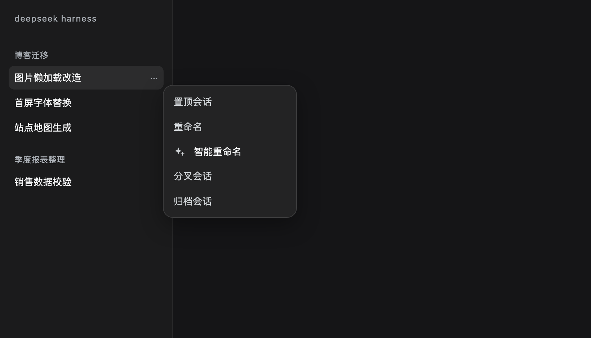
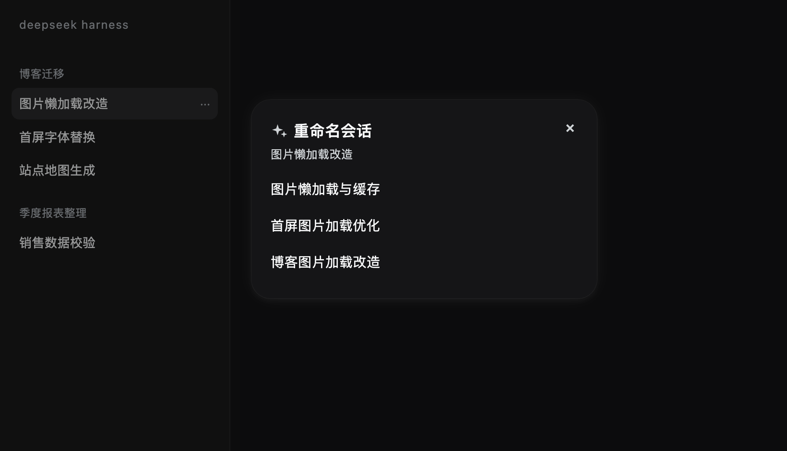
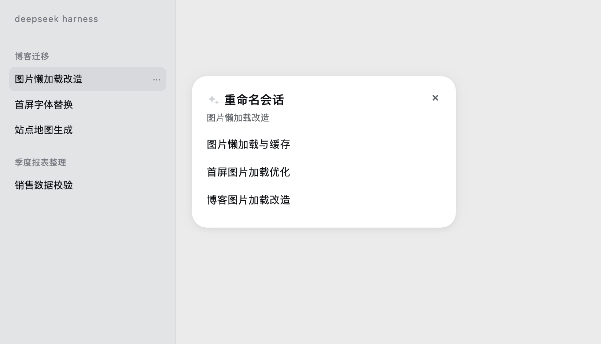
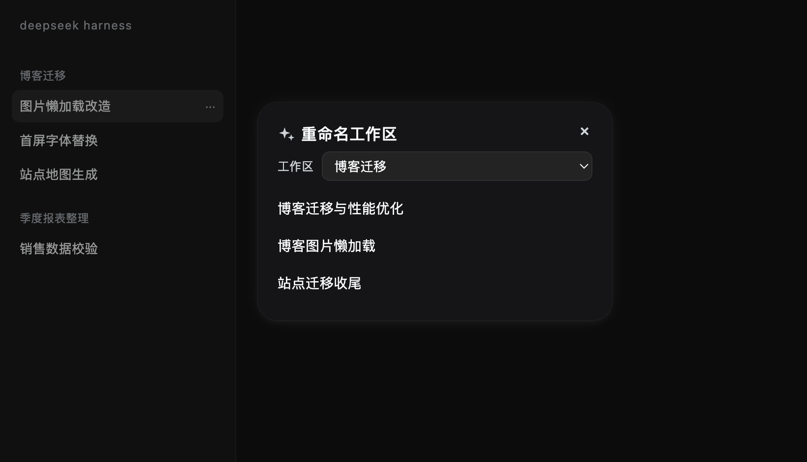
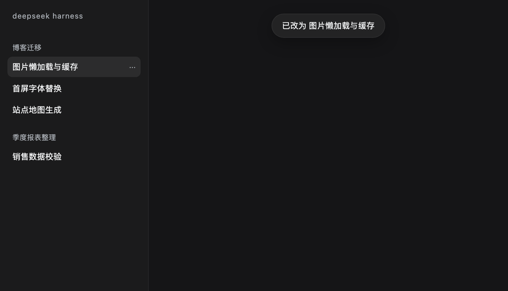
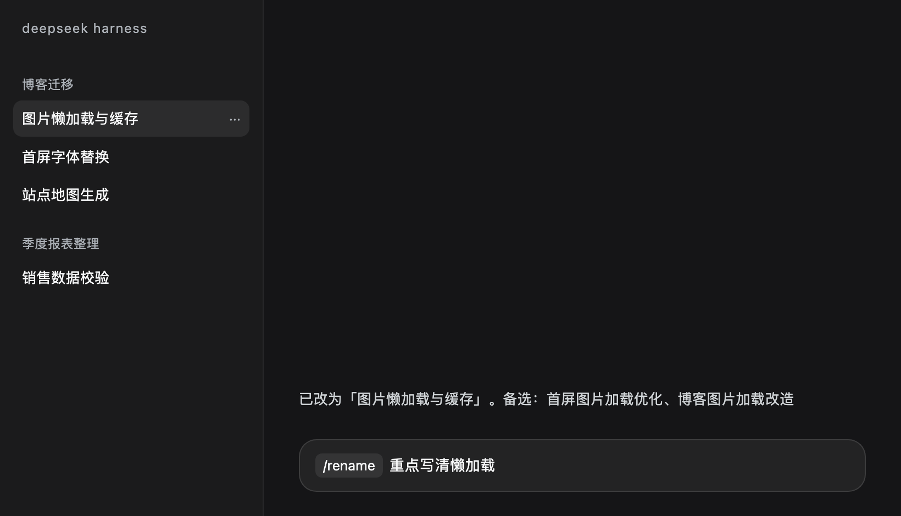

<p align="center"></p>

# Smart Namer (dsh-smart-namer)

Adds smart naming to the DSH sidebar: the model reads a session's or workspace's own content, offers a few short name candidates, and you rename by picking one. There is one entry point for sessions, one for workspaces, plus a `rename_target` tool for agents.

Only public DSH APIs are used; the host installation is never modified.

[](https://www.npmjs.com/package/dsh-smart-namer) [](LICENSE)

[中文](README.md) · [English](README.en.md)

## Install

From npm (recommended — prebuilt, no build approval):

```bash
dsh plugin --profile desktop add dsh-smart-namer
```

From GitHub (latest source):

```bash
dsh plugin --profile desktop add github:Blueteemo/dsh-smart-namer
```

From a local checkout (development):

```bash
dsh plugin --profile desktop add file:/absolute/path/to/dsh-smart-namer
```

Or use the prebuilt tarball:

```bash
dsh plugin --profile desktop add https://github.com/Blueteemo/dsh-smart-namer/releases/latest/download/dsh-smart-namer.tgz
```

If the sidebar entry does not appear, **quit the app completely (Cmd+Q) and reopen it**. The client bundle is served with an immutable cache and memoized in the host, so refreshing the page does not reload client code.

## Usage

### Session

1. Hover a session row and click `...`
2. Click **Smart rename**
3. The dialog shows "Thinking…", then up to 3 candidates
4. Pick one: it renames immediately, closes the dialog, and shows "Renamed to X"
5. `Esc` or clicking the backdrop closes without changing anything

### Workspace

Sidebar **More** menu → **Smart rename workspace**. A picker lets you switch between workspaces; candidates refresh per workspace.

### `/rename`

Type `/rename` in the composer:

- `/rename` — asks the model, applies the first candidate, replies `Renamed to "X". Alternatives: A, B`
- `/rename emphasise the tooling` — the text becomes a **preference hint** for the model; the model still generates the names
- If the model fails or returns nothing: `Couldn't think of a better name; left unchanged`
- On a session with no messages yet: `This session has no content yet — say a few things first.`

## Development

```sh
node --check index.js && node --check client.js   # syntax
node --test test/*.test.mjs                       # unit tests (Node.js >= 22)
```

`index.js` exports `apply`, `fill`, `parseNames` and `tidyName` for tests.

`client.js` is the browser bundle: the host caches it per `?rev=` and memoizes it in memory, so **changes require quitting the app (Cmd+Q)** — a page refresh is not enough.

### Manual checks

1. Say something, then Smart rename: candidates within 4 seconds, picking one renames
2. Smart rename on an empty session: says there is no content — **not** a red error
3. Rename a session and a workspace, restart the app, names persist
4. Offline or model error: only a notice, no rename
5. Check both dark and light themes

## Custom prompts

The plugin page (Settings → Plugins → dsh-smart-namer → Configure) lets you edit both prompt templates:

- **Load default template** fills the box with the built-in text so you can edit it
- **Reset to default** clears the saved value, falling back to the built-in template
- **Save** applies immediately — no restart needed

Overrides live in `~/.dsh/profiles/<profile>/dsh-smart-namer.prompts.json`. Placeholders: `{title}`, `{project}`, `{codes}`, `{user_samples}`, `{last_assistant_text}` for sessions; `{folder}`, `{codes}`, `{titles}`, `{first}` for workspaces.

## Agent tool

`rename_target` renames directly, without calling the model:

```json
{ "kind": "session", "id": "session-…", "title": "New title" }
```

`kind` is `session` or `workspace`. Session renames go through `sessionController.rename`; workspace renames go through `workspaceController.rename` (validating non-empty and uniqueness).

## Context and model

Session material: current title, owning project, available project codes, and 5 user messages sampled evenly across the conversation.

Workspace material: the decoded folder name, codes, the most recent session titles, and the first message.

Tool output, file contents and full logs are never read. Renaming uses the profile's default model; no API keys are stored in this plugin.

## What it does not do

No automatic naming, no batch mode, no caching, no retries, no multi-tier context, no local heuristics cleanup, no "think again", no history.

## Verification

Measured on DSH 0.2.1-rc.5 with profile `desktop`: candidates in about a second, sidebar updates on rename, 8 unit tests passing. Full record (origin checks, persistence locations, failure paths) in [docs/verification.md](docs/verification.md).

## Screenshots

Session menu entry:



Dark theme:



Light theme:



Workspace dialog:



Renamed toast:



`/rename` command:



## Structure

```
dsh-smart-namer/
├── index.js            # Host: /rename command, HTTP /suggest, rename_target tool, model calls
├── client.js           # Client: two menu entries, workspace dialog, toast
├── cordis.patch.yml    # plugin row
├── package.json        # npm package + dsh.bundle + dsh.client
├── locale/{zh,en}.json # labels shown by the plugin manager
├── test/               # unit tests (node --test)
├── icon.svg            # plugin icon (assets/ holds a 180px bitmap)
└── docs/               # screenshots + verification log
```

## License

MIT
