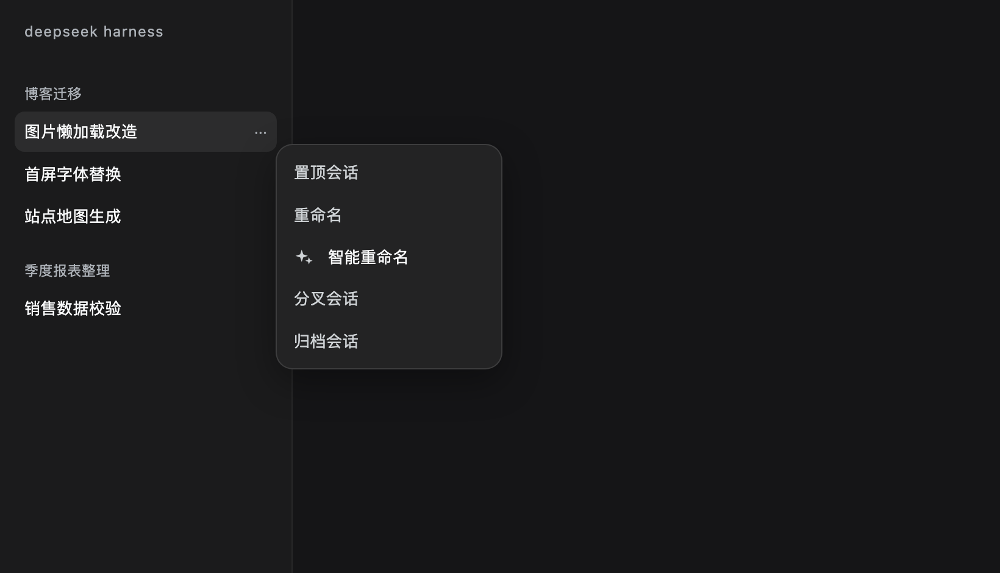
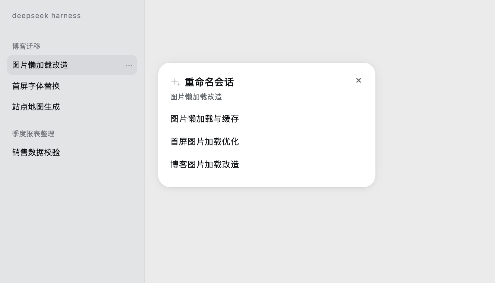
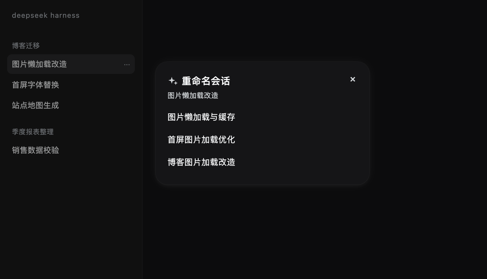
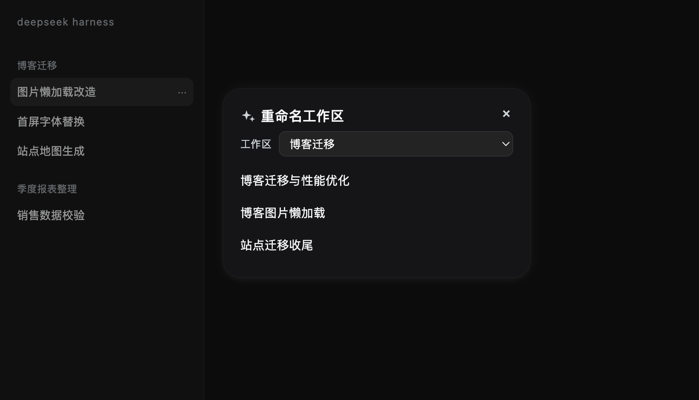
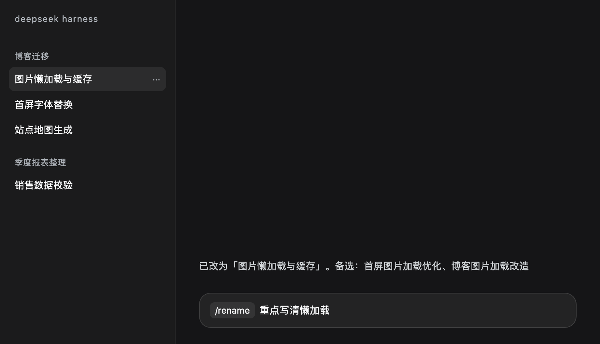
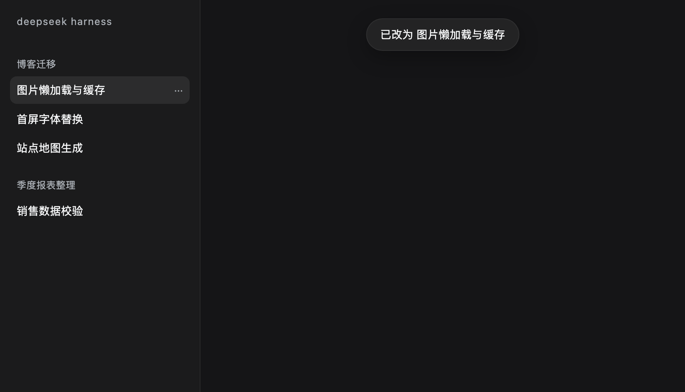

<p align="center"></p>

# 智能命名（dsh-smart-namer）

给 DSH 侧栏加一个「智能命名」：模型读取会话或工作区自身的内容，给出几个候选短名，**选中其一即可改名**。会话和工作区各有一个入口，另附一个给 Agent 用的 `rename_target` 工具。

只使用 DSH 公开接口，不修改宿主安装目录。

[](https://www.npmjs.com/package/dsh-smart-namer) [](LICENSE)

[中文](README.md) · [English](README.en.md)

## 安装

从 npm（推荐，预构建，免构建授权）：

```bash
dsh plugin --profile desktop add dsh-smart-namer
```

从 GitHub（最新源码）：

```bash
dsh plugin --profile desktop add github:Blueteemo/dsh-smart-namer
```

从本地源码（开发用）：

```bash
dsh plugin --profile desktop add file:/absolute/path/to/dsh-smart-namer
```

也可以直接用预构建包：

```bash
dsh plugin --profile desktop add https://github.com/Blueteemo/dsh-smart-namer/releases/latest/download/dsh-smart-namer.tgz
```

安装后如果侧栏没有出现入口，**完全退出 App（Cmd+Q）再打开**。客户端 bundle 有 immutable 缓存和宿主内存 memoize，刷新页面（包括硬刷新）不会重新加载客户端代码。

## 用法

### 会话

1. 在侧栏会话行点「...」。
2. 点「智能重命名」。
3. 弹窗先显示「正在想…」，随后最多给出 3 个名字。
4. 选中一个名字：立即改名、关闭弹窗，并提示「已改为 X」。
5. 按 Esc 或点遮罩：直接关闭，什么都不改。

### 工作区

1. 点侧栏面板列表的「更多」。
2. 点「智能重命名工作区」。
3. 弹窗顶部有一个工作区下拉：默认当前会话所在的工作区，其余按最近活动排序；切换下拉会重新拉候选。
4. 后续步骤与会话相同。

### `/rename` 命令

在输入框里输入 `/rename`，从命令菜单选 `rename`（会显示成命令 chip）：

- `/rename`（无参数）：调用模型，取第一个候选改名，回复「已改为「X」。备选：A、B」；失败时按原因回复（响应太慢 / 模型服务异常 / 没想出更好的），不改名。
- `/rename 突出工具链`：后面的文字作为**偏好提示**传给模型，仍然由模型生成、仍然给 3 个候选。

命令执行沿用 20 秒超时，不启动 Agent 轮次。

## 命名用到的素材

| 对象 | 素材 |
|---|---|
| **会话** | 现有标题、所属项目、项目代号、按阶段均匀采样的 5 条用户发言 |
| **工作区** | 解码后的文件夹名、代号、最近 5 个会话的标题、最近一条用户发言 |

不读工具输出、文件内容和完整日志——发给模型的就是上面这些文本。

命名用哪个模型：**会话**默认跟随它自己最近一次实际运行的模型；**工作区**没有自己的模型，用 profile 默认。两者都可以在插件配置页改（见下一节）。一次调用，超时 20 秒，不向用户流式输出；失败时会说明是响应太慢、模型服务异常（附上游原文），还是确实没给出可用名字。

## 自定义提示词与模型

插件页（设置 → 插件 → dsh-smart-namer）的 **Configure** 里有「会话命名提示词」和「工作区命名提示词」两个编辑框：

- 留空 = 使用内置模板；编辑框里灰色占位符就是内置模板本身
- 保存后**立即生效**，不需要重启
- 保存在当前 profile 目录的 `dsh-smart-namer.prompts.json`

可用占位符：

| 对象 | 占位符 |
|---|---|
| 会话 | `{project}` `{codes}` `{title}` `{user_samples}` `{last_assistant_text}` |
| 工作区 | `{folder}` `{codes}` `{workspace_path}` `{titles}` `{first_user_message}` |

调试命名效果时，可以只改提示词、不动代码，用同一个会话反复试。

## Agent 工具

`rename_target` 直接改名，不调用模型：

```json
{ "kind": "session", "id": "session-...", "title": "新名字" }
```

`kind` 为 `session` 或 `workspace`。会话改名走 `sessionController.rename`（必要时先恢复会话），工作区改名走 `workspaceController.rename`（校验非空和重名）。

## 截图

会话菜单入口：



浅色：



深色：



工作区（顶部下拉可切换）：



`/rename` 命令：



改名后的 toast：



参与开发（跑测试、目录结构、提交流程）见 [CONTRIBUTING.md](CONTRIBUTING.md)。

## License

MIT
